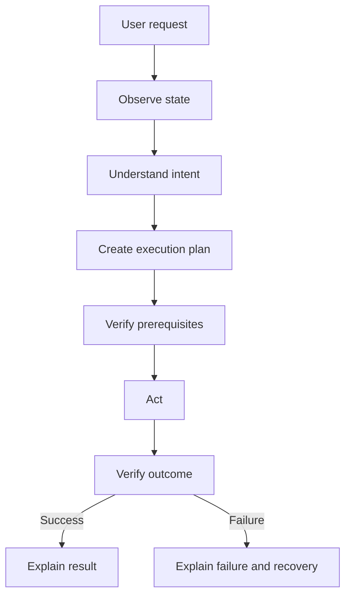

# JARVIS Reasoning Pipeline Milestone

## Summary

JARVIS now follows a deliberate reasoning loop before speaking or acting:

1. Observe the current state.
2. Understand the user intent.
3. Plan the action.
4. Verify the result.
5. Act only after the plan is grounded in context.

The rewrite is focused on reasoning quality rather than adding new commands.

## Files changed

- [brain/planner.py](../brain/planner.py)
- [models/action_result.py](../models/action_result.py)
- [services/conversation_manager.py](../services/conversation_manager.py)
- [thinking/response_generator.py](../thinking/response_generator.py)
- [dev_tests/test_reasoning_pipeline.py](../dev_tests/test_reasoning_pipeline.py)

## Architecture diagram

## Execution flow

1. The planner now tags every plan with a reasoning pipeline: observe → understand → plan → verify → act.
2. Execution proceeds only after the planner has produced a grounded plan and the executor has a structured outcome.
3. Results are not treated as success unless the outcome is verified or directly supported by a real execution result.

## Reasoning flow

- Observe the current desktop state.
- Understand whether the request is ambiguous, destructive, or context-sensitive.
- Prefer reuse over blind execution when an existing app or browser context is already present.
- Ask only for clarification when the action truly needs it.

## Recovery flow

- If an action fails, the message now includes the underlying reason and recovery hint.
- The system preserves useful information such as the browser shortcut failure and the fallback method to try next.
- The conversation manager can pause the current task when the user interrupts and resume it later.

## Test scenarios

- Open an app that is already running.
- Open a browser window when a browser instance already exists.
- Attempt a keyboard shortcut that fails and confirm the fallback explanation is surfaced.
- Interrupt a pending action and confirm the task can be paused and resumed.
- Run a destructive action and ensure confirmation remains focused on dangerous operations.

## Known limitations

- The current implementation improves reasoning quality, but it still depends on the existing parser and handler coverage.
- World-state inspection is best-effort and may be incomplete when browser or system state is unavailable.
- Full conversational interruption semantics will continue to improve as more voice and execution paths become instrumented.

## Future improvements

- Add richer world-state snapshots for clipboard, media, and open tabs.
- Expand the planner to reason over follow-up intent chains and prior commands.
- Add end-to-end tests for interruption, resume, and self-recovery.
- Introduce deeper recovery strategies such as fallback app launch paths and browser-specific alternatives.
